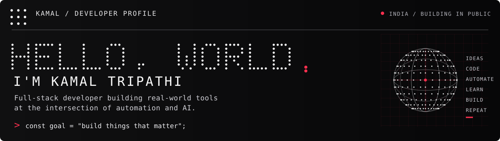
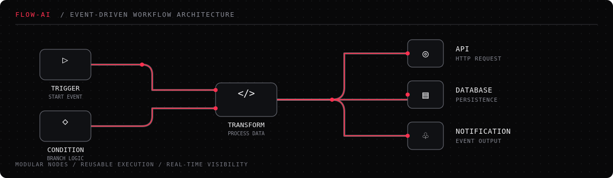

  

  <a href="https://leetcode.com/u/KAMAL_TRIPATHI/">LEETCODE ↗</a>
  &nbsp; · &nbsp;
  <a href="https://github.com/iam-KamalTripathi/Flow-Ai">FLOW-AI ↗</a>
  &nbsp; · &nbsp;
  <a href="https://github.com/iam-KamalTripathi?tab=repositories">REPOSITORIES ↗</a>

---

## 01 / ABOUT

I'm a B.Tech student and developer who enjoys building useful software, exploring AI, and understanding how reliable systems work. I'm especially interested in **backend engineering, workflow automation, and developer tools**.

`CURRENTLY BUILDING` &nbsp; Flow-Ai — an event-driven workflow automation engine  
`BASED IN` &nbsp; India · PSIT Kanpur (AKTU)

---

## 02 / FEATURED BUILD

### Flow-Ai — workflow automation engine

A modular platform for designing, validating, executing, and monitoring workflows. I'm exploring how reusable nodes, reliable execution, Git-based workflow sync, and real-time visibility can fit together in one system.

  

**CORE STACK**  
`TypeScript` &nbsp; `React Flow` &nbsp; `Node.js` &nbsp; `Redis` &nbsp; `BullMQ`

[VIEW FLOW-AI REPOSITORY ↗](https://github.com/iam-KamalTripathi/Flow-Ai)

---

## 03 / TECH STACK

A practical toolkit, grouped by where I use it — not ranked by arbitrary skill bars.

**LANGUAGES**  

**FRONTEND**  

**BACKEND & APIs**  

**DATA, TOOLS & INFRASTRUCTURE**  

**AI / ML — EXPLORING**  

---

## 04 / CURRENTLY EXPLORING

- **DSA & problem solving** — revising fundamentals and improving consistency.
- **Agentic AI** — learning patterns for tool-using agents and workflow orchestration.
- **Distributed systems & system design** — understanding queues, events, reliability, and scale.

---

## 05 / CONNECT

Have an interesting problem or an idea worth building? I'd be glad to connect.

  <a href="https://leetcode.com/u/KAMAL_TRIPATHI/">LEETCODE ↗</a>
  &nbsp; · &nbsp;
  <a href="mailto:iamkamaltripathi@gmail.com">EMAIL ↗</a>
  &nbsp; · &nbsp;
  <a href="https://github.com/iam-KamalTripathi?tab=repositories">ALL PROJECTS ↗</a>

IDEAS → CODE → SYSTEMS → LEARN → REPEAT

